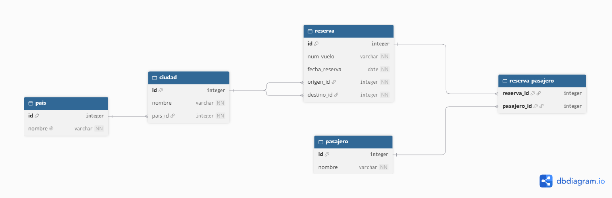

# AirTortilla · Entrega 2 (Django + base de datos)

Sistema de reservas de AirTortilla migrado de **Java (CSV en memoria)** a **Python + Django con base de datos relacional**.
Añade login (US1), alta de usuarios por roles (US2) y trazabilidad de los cambios (US3).

- **Stack**: Python 3.14 · Django 6.1 · SQLite en local · PostgreSQL en Docker
- **Versión anterior** (Java, v2.0.0): carpeta [`../AirTortilla`](../AirTortilla/README.md), sin cambios.
- **Enunciado**: [`docs/enunciado_entrega2.pdf`](docs/enunciado_entrega2.pdf)

---

## 1. Tareas medibles

Las User Stories y la migración convertidas en tareas con un criterio de aceptación comprobable:

| # | Tarea | Hecha cuando… | Estado |
|---|---|---|---|
| T1 | Entorno y proyecto Django | `runserver` arranca sin errores y `migrate` aplicado | ✅ |
| T2 | Diseño del modelo relacional | Diagrama E-R en `docs/` con tablas, claves y relaciones | ✅ |
| T3 | Modelos y migraciones | `migrate` crea las tablas y se ven en el panel de administración | ✅ |
| T4 | Importar el CSV a la BD | `importar_csv` carga las 71 reservas, informa de las líneas erróneas y no duplica si se repite | ✅ |
| T5 | Lógica sobre la BD | Localizadores, ordenación, búsqueda y ficheros por país leen de la BD | ✅ |
| T6 | **US1 · Login** | Sin sesión no se accede a nada: web y API redirigen al login | ✅ |
| T7 | **US2 · Alta de usuarios** | Un administrador crea un empleado desde el panel y ese empleado puede entrar | ✅ |
| T8 | **US3 · Trazabilidad** | Cada alta, cambio o borrado queda registrado con usuario, fecha y valores anteriores; también los accesos | ✅ |
| T9 | API + web 3D | La web de la v2.0 funciona igual, pero sobre Django y con login | ✅ |
| T10 | Versión terminal | `python manage.py airtortilla` muestra el menú de siempre (0-8) | ✅ |
| T11 | Docker *(deseable)* | `docker compose up` arranca Django + PostgreSQL | ✅ |
| T12 | Documentación | Este README | ✅ |

---

## 2. Modelo de datos



| Tabla | Qué guarda | Claves |
|---|---|---|
| `pais` | Código ISO del país (`ES`, `US`…) | PK `id` · `nombre` único |
| `ciudad` | Ciudad y su país | PK `id` · FK `pais` · única la pareja nombre + país |
| `pasajero` | Nombre del pasajero | PK `id` · `nombre` único |
| `reserva` | Código (`R0001`), vuelo, fecha, origen y destino | PK `id` · `codigo` único · FK `origen` y `destino` → `ciudad` |
| `reserva_pasajeros` | Tabla intermedia N:M | FK `reserva` + FK `pasajero` (pareja única) |

**Decisiones de diseño**

- **Normalización**: el país ya no se repite en cada reserva; se llega a él por `reserva → ciudad → pais`.
- **Reserva ↔ Pasajero es N:M**: el CSV trae un pasajero por reserva, pero una reserva real puede llevar varios (familia, pareja…). El modelo ya lo admite.
- **`codigo` guarda el `IdReserva` del CSV** y es único: así la importación sabe si una reserva ya existe y no la duplica.
- **El localizador (`LOC-0001`…) no se guarda**: se calcula con un `GROUP BY` (mismo pasajero + origen + destino, 2 o más reservas). Si entra una reserva nueva, los grupos se actualizan solos.

---

## 3. User Stories

### US1 · Login
- `LoginRequiredMiddleware` protege **todas** las URLs: sin sesión, la web y la API redirigen a `/accounts/login/`.
- Pantalla de login con el estilo de la web: `reservas/templates/registration/login.html`.
- Arriba a la derecha de la web: usuario, acceso al panel y **Cerrar sesión**.

### US2 · Alta de usuarios (roles)
Control de acceso por roles con **mínimo privilegio**. Los grupos se crean solos con `migrate` (`reservas/migrations/0004_grupos_roles.py`):

| Rol | Puede |
|---|---|
| **Agente** | Ver todo · crear y modificar reservas y pasajeros |
| **Supervisor** | Lo del agente + borrar reservas y pasajeros + gestionar ciudades y países |
| **Administrador de sistemas** | Lo del supervisor + gestionar usuarios + ver el registro de accesos |

**Dar de alta un empleado**: Panel → *Users* → *Add user* → usuario y contraseña → *Save* → marcar *Staff status* y elegir su rol en *Groups* → *Save*.

### US3 · Trazabilidad
- **Cambios en los datos**: `django-simple-history` guarda una copia de cada reserva, pasajero, ciudad y país en cada alta (`+`), cambio (`~`) o borrado (`-`), con **usuario, fecha y valores anteriores**. En el panel: botón **History** de cada ficha.
- **Accesos**: el modelo `RegistroAcceso` apunta cada inicio de sesión, cierre e **intento fallido** con usuario, fecha e IP (señales en `reservas/signals.py`). Es de solo lectura.
- La importación solo guarda una reserva si algo ha cambiado, para que el historial no se llene de cambios vacíos.

---

## 4. Migración Java → Django

| Java (v2.0) | Django (Entrega 2) |
|---|---|
| `Reserva` (clase en memoria) | Modelos `Pais`, `Ciudad`, `Pasajero`, `Reserva` (`reservas/models.py`) |
| `CsvReservaRepository` | `servicios.importar_csv()` → guarda en la BD con las mismas validaciones |
| `ReservaService.ordenar()` con MergeSort | `servicios.reservas_ordenadas()` → `ORDER BY` en la BD |
| `buscarPorId()` con búsqueda binaria | `servicios.buscar_por_codigo()` → índice único de la BD |
| `asignarLocalizadores()` con un `Map` | `servicios.grupos_localizador()` → `GROUP BY` + `HAVING COUNT >= 2` |
| `ExportadorPorPais` / `ConsultaFicheros` | `servicios.exportar_por_pais()`, `listar_ficheros()`, `leer_fichero()` |
| `ReservaController` (Spring) | `reservas/api.py` (mismas URLs y mismo JSON) |
| `ConsolaUI` | `python manage.py airtortilla` |
| Frontend 3D (`static/`) | El mismo, en `reservas/static/web/` + `templates/web/index.html` |

Comprobado: los 27 ficheros por país que genera Django son **idénticos** a los de la versión Java.

---

## 5. Puesta en marcha

### En local (SQLite)

```powershell
cd AirTortilla-django
py -3.14 -m venv .venv                     # solo la primera vez
.\.venv\Scripts\Activate.ps1
python -m pip install -r requirements.txt
python manage.py migrate                   # crea las tablas y los 3 roles
python manage.py createsuperuser
python manage.py importar_csv              # carga AirTortilla/data/AirTortilla_Reservas_2020.csv
python manage.py runserver                 # http://127.0.0.1:8000
```

> El CSV no está en GitHub: hay que copiarlo a `AirTortilla/data/`.

### Con Docker (PostgreSQL)

```powershell
cd AirTortilla-django
copy .env.example .env                     # y cambiar claves y contraseñas
docker compose up --build                  # http://localhost:8000
```

Al arrancar, el contenedor aplica las migraciones, crea el superusuario del `.env` e importa el CSV si existe.
Los datos se guardan en el volumen `datos_postgres`. Para borrarlo todo: `docker compose down -v`.

### Comandos

| Comando | Qué hace |
|---|---|
| `python manage.py importar_csv [ruta]` | Importa un CSV a la BD (por defecto, el de `AirTortilla/data`) |
| `python manage.py airtortilla` | Menú de terminal 0-8 |
| `python manage.py populate_history --auto` | Crea el primer registro de historial de los datos que ya existían |

---

## 6. API

Todas las rutas exigen sesión. Las `POST` necesitan el token CSRF (la web lo envía sola).

| Método | Ruta | Qué devuelve |
|---|---|---|
| GET | `/api/estado` | Contadores y errores de la última carga |
| POST | `/api/cargar/defecto` | Importa el CSV por defecto |
| POST | `/api/cargar` | Importa un CSV subido (`fichero`) |
| GET | `/api/reservas?orden=ID\|FECHA\|PASAJERO\|PAIS_DESTINO` | Reservas ordenadas |
| GET | `/api/reservas/{codigo}` | Una reserva |
| GET | `/api/localizadores` | Grupos con localizador |
| POST | `/api/ficheros/generar` | Genera los ficheros por país |
| GET | `/api/ficheros` | Ficheros generados |
| GET | `/api/ficheros/{nombre}` | Un fichero completo |
| GET | `/api/ficheros/{nombre}/lineas/{n}` | Solo la línea `n` |

---

## 7. Estructura

```
AirTortilla-django/
├── config/                 settings.py (BD por variables de entorno), urls.py
├── reservas/
│   ├── models.py           tablas + historial + RegistroAcceso
│   ├── servicios.py        lógica (importar, ordenar, buscar, localizadores, ficheros)
│   ├── api.py · urls.py    API REST para la web
│   ├── views.py            portada (web 3D)
│   ├── signals.py          registro de inicios de sesión
│   ├── admin.py            panel con historial
│   ├── management/commands/  importar_csv · airtortilla
│   ├── migrations/         0001-0003 tablas · 0004 roles · 0005 historial · 0006 permisos
│   ├── templates/          login y web
│   └── static/web/         CSS, JS, Three.js y texturas de la Tierra
├── docs/                   enunciado y diagrama E-R
├── Dockerfile · docker-compose.yml · docker-entrypoint.sh · .env.example
└── requirements.txt
```
