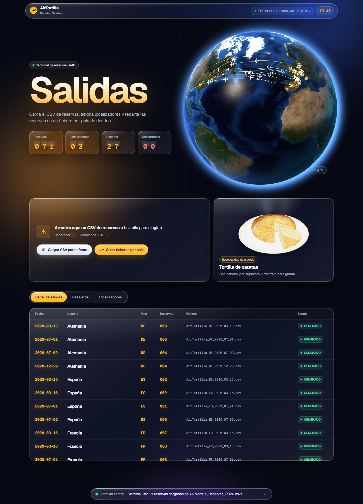
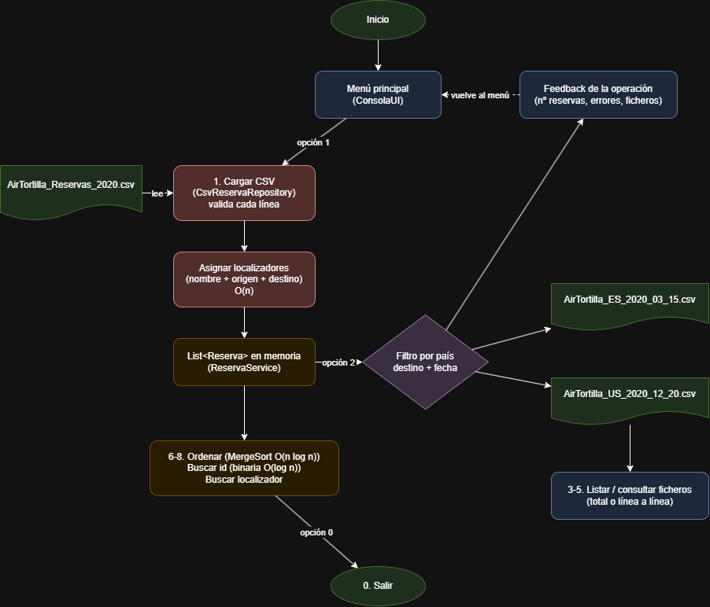
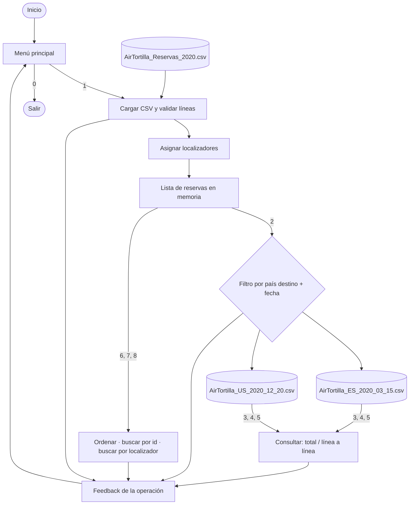

# AirTortilla Booking System

Aplicación web en Java (Spring Boot) que lee las reservas de AirTortilla desde un fichero CSV, asigna
**localizadores** a los pasajeros coincidentes y **divide las reservas en ficheros por país de destino**.



## Stack tecnológico

| Elemento | Versión / elección |
|---|---|
| Lenguaje | Java 21 (Temurin) |
| Build | Maven |
| Backend | Spring Boot 3.3 (API REST que devuelve JSON) |
| Interfaz | **Web** (HTML + CSS + JavaScript, estilo Liquid Glass, Three.js: globo terráqueo, avión y tortilla 3D) · alternativas: Swing (`--swing`) y terminal (`--consola`) |
| Persistencia | Ficheros CSV |
| IDE | IntelliJ IDEA |

## Cómo ejecutarlo

1. Abrir la carpeta `AirTortilla` en IntelliJ (*File → Open*). IntelliJ detecta el `pom.xml` y descarga Spring Boot
   (la primera vez tarda un poco; si no lo hace solo, pulsa el icono de Maven ⟳ *Reload*).
2. Copiar el CSV de datos en `data/AirTortilla_Reservas_2020.csv` (no está en el repo; ver formato abajo).
   También se puede **arrastrar cualquier CSV** a la página.
3. Ejecutar `com.airtortilla.Main` (botón ▶ junto al `main`). Arranca el servidor y se abre el navegador en
   **http://localhost:8080**. Para pararlo, el botón ■ rojo de IntelliJ.

Argumentos opcionales:

| Argumentos | Interfaz |
|---|---|
| *(ninguno)* | Web en http://localhost:8080 |
| `--swing [ficheroEntrada] [carpetaSalida]` | Ventana de escritorio Swing |
| `--consola [ficheroEntrada] [carpetaSalida]` | Menú de terminal |

En la web, las rutas y el puerto se cambian en `src/main/resources/application.properties`.
Three.js y las texturas de la Tierra (NASA Blue Marble, vía three-globe) están incluidas en `static/`, así que todo funciona sin internet (solo las fuentes tipográficas vienen de Google Fonts).

## Formato del CSV de entrada

- Codificación **UTF-8**, separador **`;`**, primera línea = cabecera.
- El fichero de datos **no se sube al repositorio** (está en `.gitignore`). Hay un ejemplo en `data/ejemplo_reservas.csv`.

| Columna | Tipo | Formato / restricciones | Ejemplo |
|---|---|---|---|
| `IdReserva` | String | Único, obligatorio | `R0001` |
| `NombrePasajero` | String | Obligatorio | `María Fernández` |
| `Origen` | String | Ciudad | `Madrid` |
| `PaisOrigen` | String | Código ISO 3166-1 alfa-2 | `ES` |
| `Destino` | String | Ciudad | `Paris` |
| `PaisDestino` | String | Código ISO 3166-1 alfa-2 (2 letras) | `FR` |
| `FechaReserva` | Fecha | `yyyy-MM-dd` | `2020-03-15` |
| `NumeroVuelo` | String | Obligatorio | `AT1234` |

```csv
IdReserva;NombrePasajero;Origen;PaisOrigen;Destino;PaisDestino;FechaReserva;NumeroVuelo
R0061;María Fernández;Madrid;ES;Paris;FR;2020-03-15;AT1234
```

Las líneas incorrectas (columnas de más o de menos, campos vacíos, fecha inválida, país que no es ISO
de 2 letras o id repetido) se descartan y se informa de ellas en el feedback de la carga.

## Ficheros de salida

Se generan en `output/` con el nombre **`AirTortilla_XX_YYYY_MM_DD.csv`**, donde `XX` es el código ISO del
país de destino y `YYYY_MM_DD` la fecha de la reserva. Tienen las mismas columnas que la entrada más
`Localizador` (vacío si la reserva no pertenece a ningún grupo).

## Localizadores

Cuando **2 o más reservas coinciden en nombre del pasajero, origen y destino**, todas reciben el mismo
localizador (`LOC-0001`, `LOC-0002`...). Los datos de prueba incluyen 3 casos:

| Localizador | Pasajero | Trayecto | Personas |
|---|---|---|---|
| LOC-0001 | María Fernández | Madrid → Paris | 6 |
| LOC-0002 | José Rodríguez | Barcelona → Roma | 3 |
| LOC-0003 | David Jiménez | Valencia → Nueva York | 2 |

## Interfaz web

Estética *Liquid Glass*: paneles de cristal translúcido que desenfocan y refractan el fondo (filtro SVG de desplazamiento) sobre un cielo nocturno, con elementos de panel de salidas de aeropuerto.

| Zona | Funciones |
|---|---|
| Cabecera | Contadores con animación *split-flap* (reservas, localizadores, ficheros, líneas descartadas) y **globo terráqueo 3D** con texturas reales (día, noche con luces de ciudades, reflejo del sol en el mar y atmósfera), las rutas de las reservas y aviones volando (arrastrable) |
| Carga | Arrastrar un CSV a la página o cargar el CSV por defecto · botón *Crear ficheros por país*: al pulsarlo cruza la pantalla un **avión de pasajeros 3D** con estelas |
| Tortilla | **Tortilla de patatas 3D** en un plato, con un trozo cortado que muestra el interior y vapor (arrastrable) |
| **Panel de salidas** | Los ficheros generados como un tablero de aeropuerto (fecha, país, nº de reservas). Al pulsar uno se abre el visor: **completo** o **línea a línea** (botón *Siguiente línea* o tecla Espacio) |
| **Pasajeros** | Tabla de reservas · ordenar con MergeSort · buscar por id (búsqueda binaria) · filtro de texto · pulsar un localizador muestra su grupo |
| **Localizadores** | Cada grupo como una tarjeta de embarque con el nº de pasajeros |
| Torre de control | Feedback de cada operación con la hora (desplegable) |

### API REST

La página llama a estas URLs (`web/ReservaController.java`), que usan los mismos servicios que Swing y la consola:

| Método | URL | Qué hace |
|---|---|---|
| GET | `/api/estado` | Contadores y errores de la última carga |
| POST | `/api/cargar/defecto` | Carga el CSV configurado |
| POST | `/api/cargar` | Carga un CSV subido desde el navegador (campo `fichero`) |
| GET | `/api/reservas?orden=FECHA` | Reservas ordenadas (`ID`, `FECHA`, `PASAJERO`, `PAIS_DESTINO`) |
| GET | `/api/reservas/{id}` | Una reserva (búsqueda binaria) · 404 si no existe |
| GET | `/api/localizadores` | Grupos con localizador |
| POST | `/api/ficheros/generar` | Crea los ficheros por país de destino |
| GET | `/api/ficheros` | Ficheros generados (nombre, país, fecha, nº de reservas) |
| GET | `/api/ficheros/{nombre}` | Modalidad total: el fichero completo |
| GET | `/api/ficheros/{nombre}/lineas/{n}` | Modalidad línea a línea: solo la línea `n` |

Solo se pueden leer ficheros de la carpeta de salida: un nombre como `../pom.xml` se rechaza.

## Interfaz Swing (`--swing`)

| Zona | Funciones |
|---|---|
| Barra superior | Elegir el CSV (*Examinar...*) y cargarlo (*Cargar CSV*) |
| Pestaña **Reservas** | Tabla con todas las reservas · ordenar por id, fecha, pasajero o país destino · buscar por id · buscar por localizador |
| Pestaña **Ficheros por país** | Crear los ficheros por país de destino · lista de ficheros generados · ver un fichero completo o línea a línea (botón *Siguiente línea*) |
| Panel inferior | Feedback de cada operación con la hora (reservas leídas, errores, ficheros creados...) |

## Menú de consola (`--consola`)

```
1. Cargar CSV de reservas
2. Crear ficheros por país de destino
3. Listar ficheros generados
4. Consultar fichero (total)
5. Consultar fichero (línea a línea)
6. Listar reservas ordenadas
7. Buscar reserva por id
8. Buscar reservas por localizador
0. Salir
```

## Diagrama de flujo



El original editable está en [`docs/diagrama_flujo.drawio`](docs/diagrama_flujo.drawio) (abrir con [draw.io](https://app.diagrams.net)).



## Arquitectura

```
src/main/java/com/airtortilla
├── Main.java                     Conecta las piezas
├── model/Reserva.java            Entidad (Comparable por id)
├── repository/
│   ├── ReservaRepository.java    Interfaz de acceso a datos
│   └── CsvReservaRepository.java Implementación con CSV
├── service/
│   ├── ReservaService.java       Carga, localizadores, ordenar, buscar
│   ├── ExportadorPorPais.java    Genera los ficheros por país
│   └── ConsultaFicheros.java     Lectura total y línea a línea
├── util/
│   ├── MergeSort.java            Ordenación genérica O(n log n)
│   └── BusquedaBinaria.java      Búsqueda O(log n)
├── ui/
│   ├── VentanaPrincipal.java     Interfaz gráfica (Swing)
│   └── ConsolaUI.java            Interfaz de terminal
└── web/
    ├── AirTortillaWebApp.java    Arranque de Spring Boot y creación de los servicios
    └── ReservaController.java    API REST (JSON) que usa la página

src/main/resources
├── application.properties        Puerto y rutas por defecto
└── static/                       Página web
    ├── index.html
    ├── css/app.css
    └── js/
        ├── app.js                Llama a la API y pinta los datos
        ├── globo.js              Globo terráqueo 3D
        ├── despegue.js           Avión 3D del despegue
        └── tortilla.js           Tortilla de patatas 3D
    ├── lib/three.min.js          Three.js r128 (incluido para funcionar sin internet)
    └── img/                      Texturas de la Tierra
```

Por capas: la interfaz solo habla con los servicios, y los servicios no saben de dónde vienen los datos.
Para migrar a otra fuente (por ejemplo una base de datos con JDBC) basta con añadir otra
implementación de `ReservaRepository`, sin tocar el resto. Para otra interfaz (web, JavaFX), basta con
añadir otra capa de interfaz: así se hizo en la 1.1.0 con `VentanaPrincipal` y en la 2.0.0 con el paquete `web`,
sin cambiar la lógica de ningún servicio. Las tres interfaces siguen funcionando a la vez.

## Complejidad algorítmica

| Operación | Algoritmo | Coste |
|---|---|---|
| Cargar CSV | Un recorrido + `HashSet` para ids duplicados | O(n) |
| Asignar localizadores | Agrupar con `Map` por (nombre, origen, destino) | O(n) (comparar todos con todos sería O(n²)) |
| Generar ficheros | Agrupar con `TreeMap` y escribir | O(n log k), k = nº de ficheros |
| Listar ordenadas | MergeSort propio (estable, sirve para objetos) | O(n log n) |
| Buscar por id | Búsqueda binaria sobre la lista ordenada por id | O(log n) |
| Buscar por localizador | Recorrido lineal | O(n) |

## Historial de versiones

| Versión | Fecha | Cambios |
|---|---|---|
| 1.0.0 | 2026-10-14 | Primera entrega: lectura de CSV, localizadores, ficheros por país de destino, consulta total y línea a línea, ordenación y búsqueda. Stack: Java 21 + consola + ficheros. |
| 1.1.0 | 2026-10-14 | **Migración de interfaz: terminal → interfaz gráfica nativa (Swing).** Nueva clase `VentanaPrincipal` con pestañas de reservas y ficheros, y panel de feedback. La consola se mantiene con `--consola`. Los servicios no cambian; solo se añade `ConsultaFicheros.abrir()` para la lectura línea a línea desde botones. |
| 2.0.0 | 2026-10-14 | **Migración de interfaz: escritorio → web.** Se añade Spring Boot: `AirTortillaWebApp` arranca un servidor en localhost:8080 y `ReservaController` expone una API REST en JSON. Página nueva en HTML/CSS/JS con estética de aeropuerto, globo 3D con Three.js, subida de CSV por arrastre y visor de ficheros. La web pasa a ser la interfaz por defecto; Swing (`--swing`) y consola (`--consola`) se mantienen. En los servicios solo se añade `ReservaService.getGruposLocalizador()`. |
